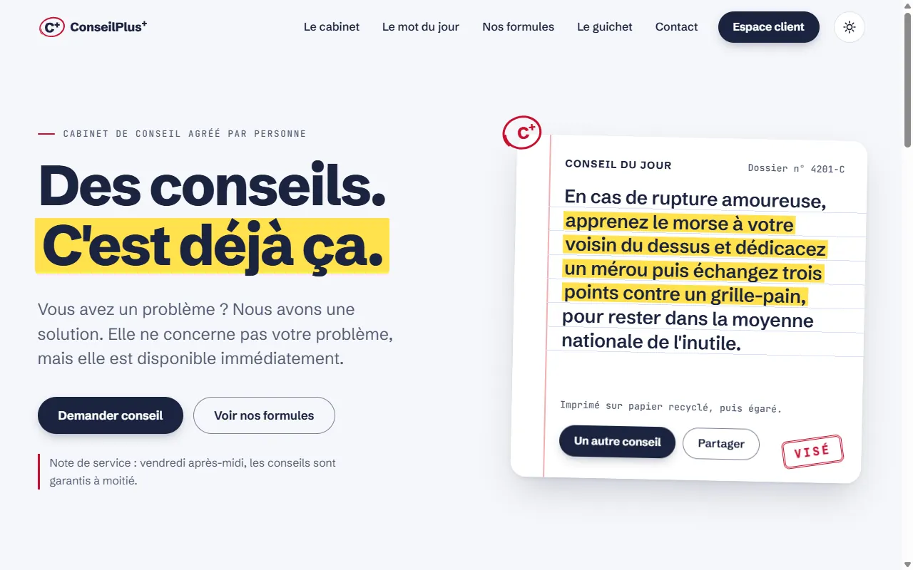
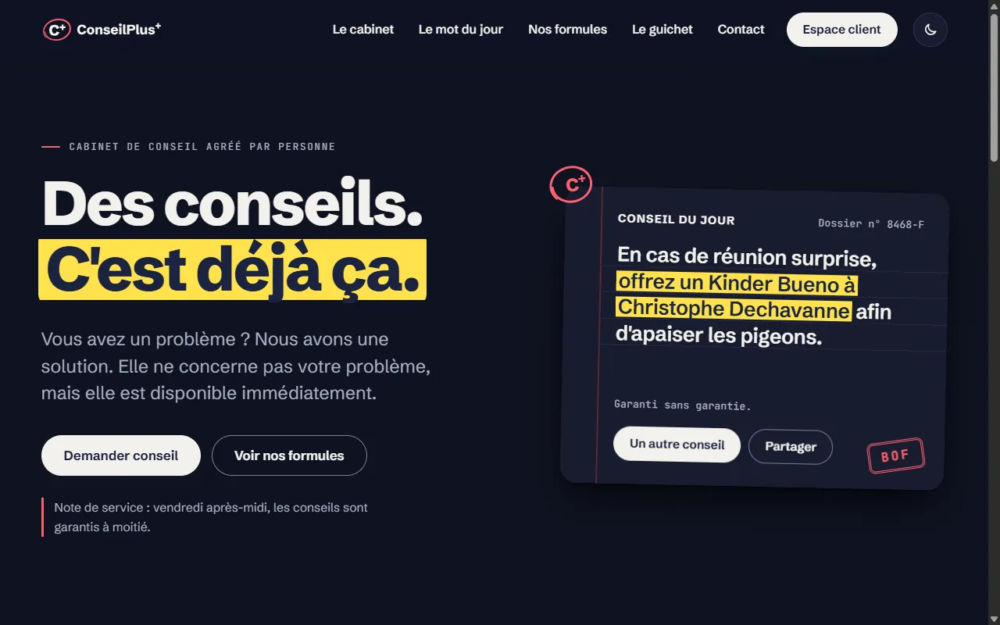
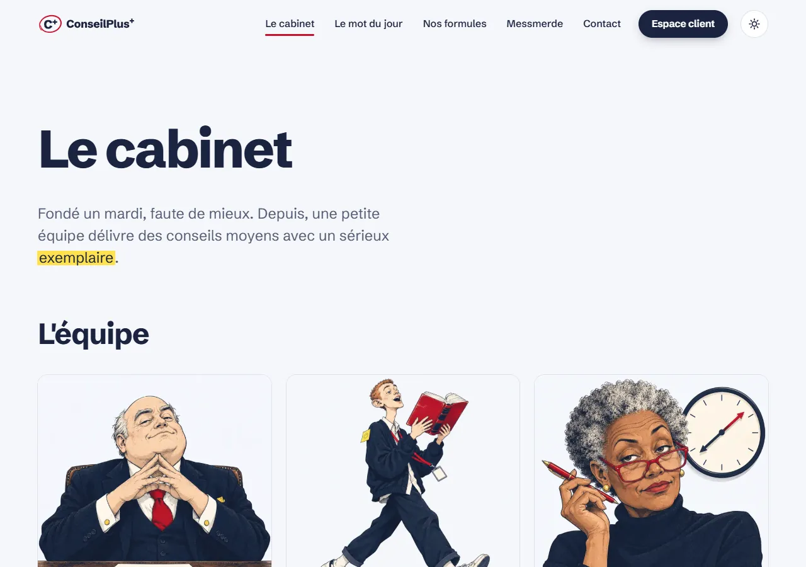
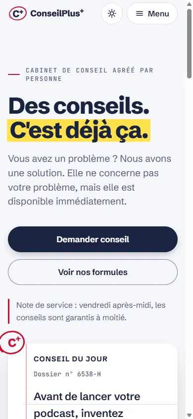
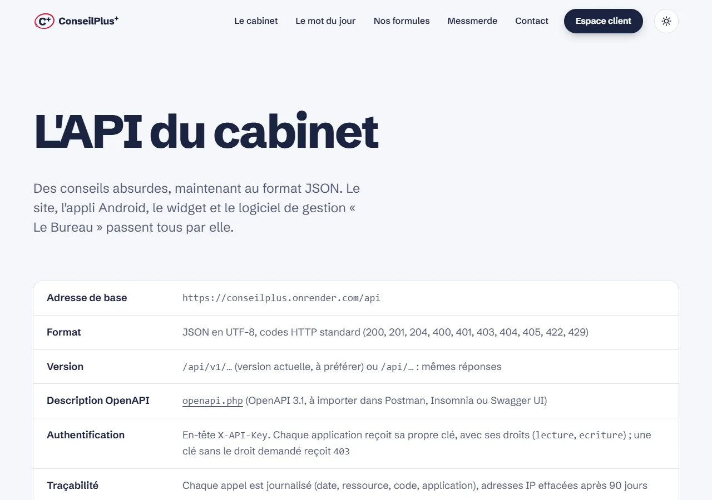
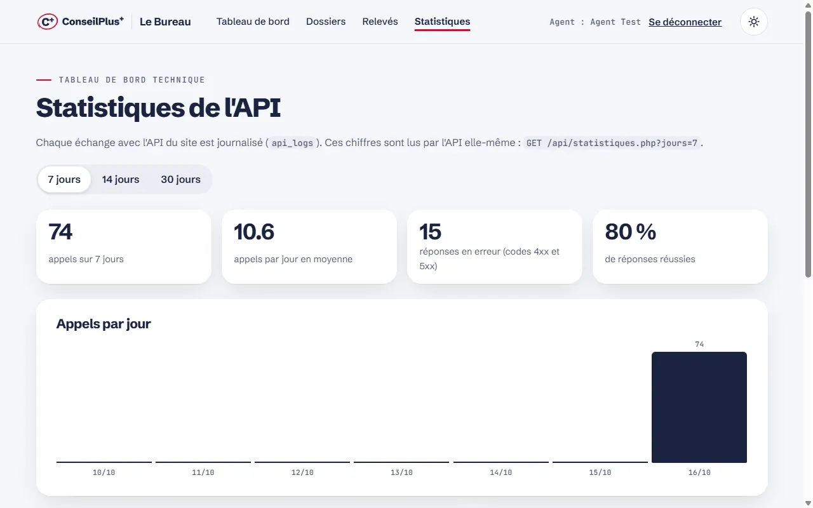
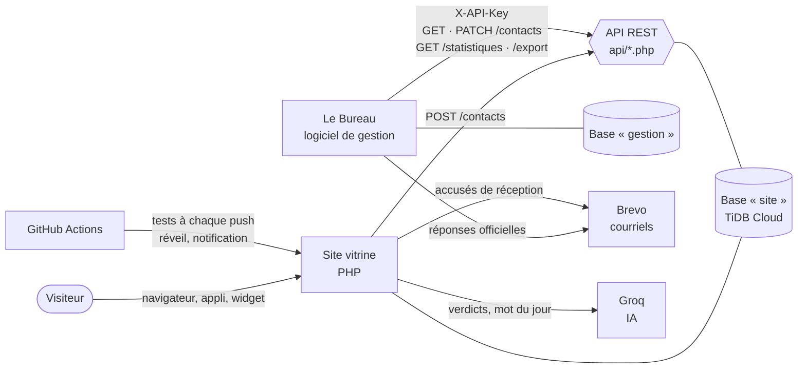

<p align="center">
  
</p>

<p align="center">
  <strong>Des conseils. C'est déjà ça.</strong><br>
  Un faux cabinet de conseil qui répond à vos problèmes par des conseils absurdes, avec le plus grand sérieux.
</p>

<p align="center">
  <a href="https://conseilplus.onrender.com"><strong>conseilplus.onrender.com</strong></a> ·
  <a href="https://conseilplus.onrender.com/developpeurs.php">L'API</a> ·
  <a href="https://github.com/Viktor59000/ConseilPlusPlus/releases/download/android/conseilplus.apk">Appli Android</a><br><br>
  <a href="https://github.com/Viktor59000/ConseilPlusPlus/actions/workflows/tests.yml"></a>
</p>

---

Projet du cours **« API PHP — Du site vitrine au logiciel de gestion »** (semestre 5) : un site vitrine en PHP / MySQL,
une **API REST** qui expose ses données, et un **logiciel de gestion** séparé (« Le Bureau ») qui ne communique avec
le site que par cette API.



| Thème sombre | Le cabinet | Mobile |
|---|---|---|
|  |  |  |

| Documentation de l'API | Le Bureau : statistiques de l'API |
|---|---|
|  |  |

## Ce que fait le site

- **Le conseil du jour** : trois morceaux de phrases sans rapport, assemblés en un conseil officiel, tamponné et numéroté
  (« Dossier n° 4339-I »). Un autre conseil en un clic, sans compte.
- **Le Petit Moyen** : le mot (presque) du jour, fausse définition ou sketch du conseiller et de son stagiaire,
  préparé chaque nuit par une IA (Groq), avec 120 mots et 30 sketchs de secours. Votes « Moyen / Pas moyen ».
- **Espace client** : Mon conseil, une **Consultation** (questionnaire inutile et verdict de l'IA), **Le Duel**
  (partie en 100 points contre le cabinet, tableau d'honneur), **Mon carnet**, **Mon compte** (suppression RGPD).
- **Le standard** de Mireille (répondeur à choix, file qui finit à la machine à café), **Le cabinet** (l'équipe), les formules
  (et le faux paiement Premium), le formulaire de contact avec accusé de réception par courriel.
- **Mobile** : site installable, notification quotidienne du mot du jour (Web Push écrit à la main), appli Android
  avec widget, partage d'un conseil en image story.
- **Le Bureau** (`bureau/`) : relève les demandes de contact par l'API, dossiers, réponses officielles par courriel
  (trois tons), statistiques de l'API, sauvegarde des bases en un clic.

## Architecture



- Le Bureau a **sa propre base** et ne lit jamais celle du site : tout passe par l'API (clé `X-API-Key`).
- Chaque appel de l'API est **journalisé** (`api_logs` : date, ressource, code, application ; IP effacées après 90 jours).
- En ligne : **Render** (Docker, PHP 8.3 + Apache) et **TiDB Cloud** (MySQL, Francfort), redéployés à chaque push.

## L'API

Documentation interactive (bouton « Essayer ») : **[conseilplus.onrender.com/developpeurs.php](https://conseilplus.onrender.com/developpeurs.php)**,
détail dans [docs/API.md](docs/API.md).

| Ressource | Méthodes | Accès | Rôle |
|---|---|---|---|
| `/contacts.php` | `POST` · `GET` · `PATCH` · `DELETE` | public (POST) / clé | Demandes de contact, du site vers le logiciel de gestion |
| `/conseils.php` | `GET` | public | Conseils aléatoires |
| `/mot-du-jour.php` | `GET` · `POST` | public | Mot du jour ; préparation par l'IA du mot de demain |
| `/widget.php` | `GET` | public | Données prêtes à afficher pour un widget |
| `/votes.php` | `GET` · `POST` | public | Votes et palmarès des mots |
| `/notifications.php` | `GET` · `POST` | public | Abonnement et envoi des notifications Web Push |
| `/mes-conseils.php` | `GET` · `POST` · `DELETE` | session + CSRF | Carnet du client connecté |
| `/statistiques.php` | `GET` | clé | Usage de l'API (pour Le Bureau) |
| `/export.php` | `GET` | clé | Sauvegarde SQL de la base du site |

```bash
curl https://conseilplus.onrender.com/api/conseils.php
```

## Côté technique

| Sujet | Ce qui est en place |
|---|---|
| **PHP / MySQL** | PDO et requêtes préparées partout, tables créées et migrées automatiquement (`includes/schema.php`) |
| **Authentification** | Code du cours conservé tel quel (`auth/` : sel statique + SHA-512) ; mot de passe oublié par courriel (jeton haché, 1 h, usage unique) |
| **Sécurité** | Jetons CSRF, champ piège anti-robots, cookies `HttpOnly` / `Secure` / `SameSite`, CSP, HSTS, `X-Frame-Options`, limite des essais de connexion, limites de débit de l'API |
| **Accessibilité** | RGAA 4.1 (déclaration : partiellement conforme, audit interne), contrastes vérifiés dans les deux thèmes, 320 px et texte à 200 % |
| **Performance** | Lighthouse 98–100 / 100 / 100 / 100 sur toutes les pages (mobile) : CSS intégré et minifié, police préchargée |
| **Design** | Identité « La note » : C+ entouré au stylo rouge, thèmes clair / sombre, animations ([charte](design-system/conseilplus/MASTER.md)) |
| **Tests** | À chaque push : syntaxe PHP, toutes les pages, API et Web Push sur une vraie base MySQL ([tests.yml](.github/workflows/tests.yml)) |
| **Données** | RGPD : pages légales, suppression du compte, journal purgé ; sauvegarde des bases en un clic depuis Le Bureau |

## Installation locale (WAMP)

1. Placer le dossier dans le `www` de WAMP.
2. Copier `config.example.php` en `config.php` et `bureau/config.example.php` en
   `bureau/config.php` (valeurs locales par défaut ; clés Groq et Brevo facultatives).
3. Ouvrir `http://localhost/<dossier>/` : les bases `site` et `gestion` et leurs tables se créent au premier chargement.
4. Tests : `php tests/test_pages.php`, `php tests/test_api.php`, `php tests/test_push.php`.

Mise en ligne, variables d'environnement et sauvegardes : [docs/DEPLOIEMENT.md](docs/DEPLOIEMENT.md).
Reprendre le projet sur un autre PC : [docs/REPRISE.md](docs/REPRISE.md). Où en est-on : [docs/JOURNAL.md](docs/JOURNAL.md).

## Soutenance : démo en 5 minutes

1. **Le site (1 min)** — l'accueil : la copie du conseil, « Un autre conseil », le tampon. Basculer en thème sombre.
   Le Petit Moyen : jouer un sketch. *Message : un site vitrine complet, avec une identité.*
2. **L'API (1 min 30)** — la page [L'API du cabinet](https://conseilplus.onrender.com/developpeurs.php) : « Essayer » sur
   `/conseils.php`, puis un `curl` sans clé sur `/contacts.php` (réponse `401`). *Message : une API REST documentée,
   avec des codes HTTP justes, une clé, des limites et un journal.*
3. **Le parcours site → API → Bureau (1 min 30)** — envoyer une demande depuis Contact (accusé de réception reçu par
   courriel), puis dans Le Bureau : « Relever le courrier », ouvrir le dossier, rédiger une réponse « très administrative »,
   l'envoyer. Montrer la page Statistiques. *Message : le logiciel de gestion ne touche jamais la base du site.*
4. **La qualité (1 min)** — les tests verts sur GitHub, le rapport Lighthouse, la déclaration d'accessibilité,
   la limite des essais de connexion (« Trop d'essais »), la suppression du compte. *Message : sécurité, RGAA et RGPD
   pris au sérieux, sur un sujet qui ne l'est pas.*

Questions à préparer : pourquoi le Bureau passe par l'API plutôt que par la base (séparation, clé, journal) ;
pourquoi le hachage du cours n'est pas modifié (contrainte du sujet, `password_hash()` serait la norme) ;
que se passe-t-il si l'IA ne répond pas (banques de secours, le site ne dépend d'aucun service externe pour fonctionner).

## Arborescence

```
index.php, cabinet.php, petit-moyen.php, produit.php, messmerde.php, contact.php      pages publiques
login.php, conseil.php, consultation.php, duel.php, carnet.php, compte.php         espace client
mot-de-passe-oublie.php, reinitialiser.php, developpeurs.php, erreur-404.php
mentions-legales.php, confidentialite.php, accessibilite.php, plan-du-site.php, application.php
auth/          connexion, inscription, déconnexion (code du cours, non modifié)
api/           l'API REST (contacts, conseils, mot-du-jour, widget, votes, notifications, mes-conseils, statistiques, export)
bureau/        Le Bureau, logiciel de gestion (sa propre base « gestion »)
includes/      en-tête, pied, thème, logo, courriels, IA, Web Push, sécurité, générateurs
data/          banques de contenu (fragments, Kamoulox, mots, sketchs, questions, Duel, textes, API)
css/ js/       base.css (socle commun), style.css ; scripts en defer
assets/        polices, icônes, logo, portraits de l'équipe, images des courriels
android/       appli Android et widget (APK construit par GitHub Actions)
tests/         tests des pages, de l'API et du Web Push
docs/          API, Bureau, déploiement, reprise, journal, images ; design-system/ : la charte
docker/, Dockerfile, .github/workflows/      mise en ligne, tests, réveil, garde éveillé, appli Android
```

## Crédits

Contenus originaux. Le générateur de conseils et les sketchs du Petit Moyen sont un **hommage non officiel** au
Kamoulox (Kad Merad et Olivier Baroux) et aux « Mots » (Éric et Ramzy) : aucune réplique ni aucun visuel n'est repris.
Les personnes citées dans les conseils le sont dans des situations inoffensives et imaginaires. Polices
Schibsted Grotesk et JetBrains Mono (SIL Open Font License). Portraits de l'équipe générés par IA ([docs/IMAGES.md](docs/IMAGES.md)).
