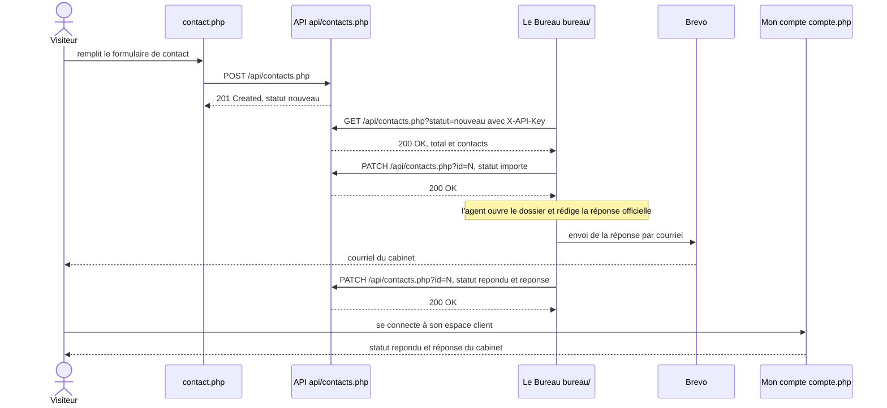
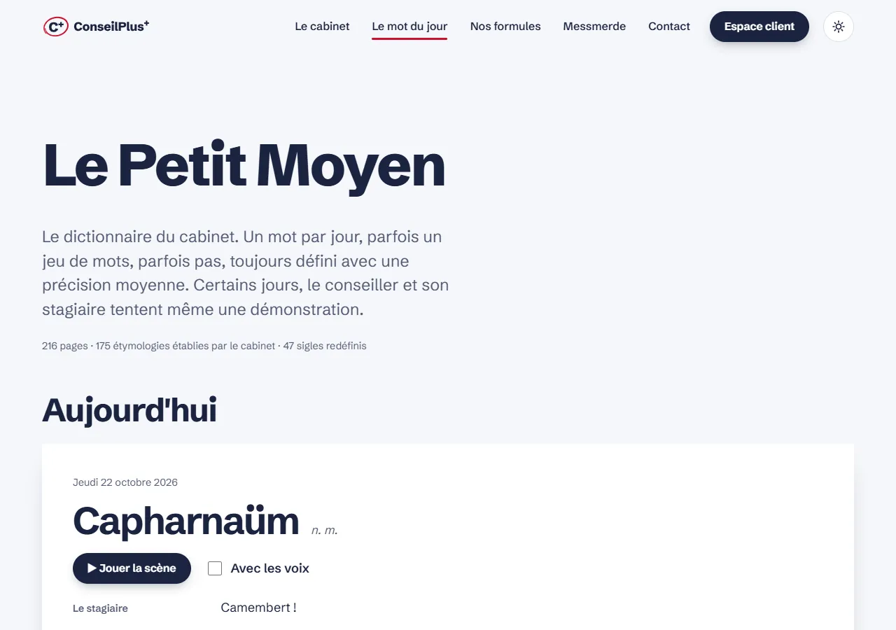
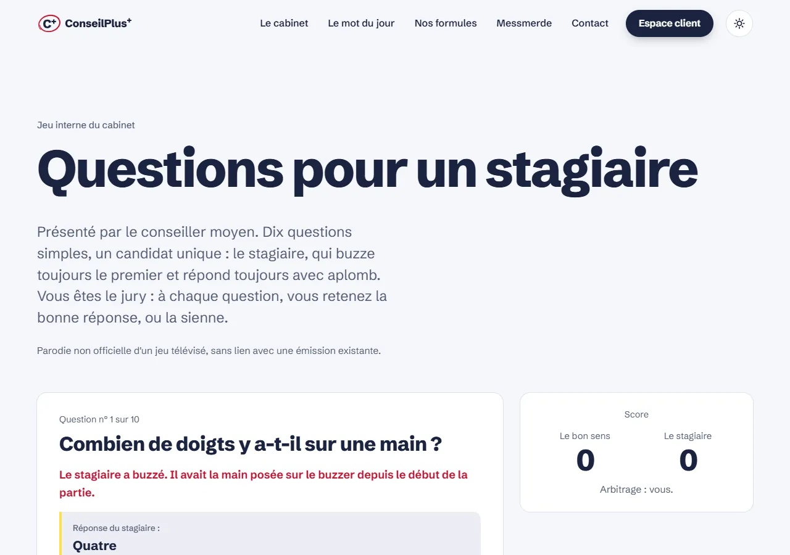
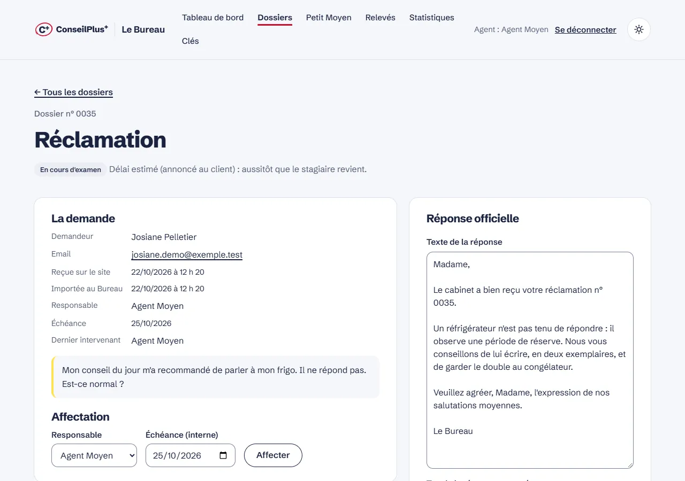
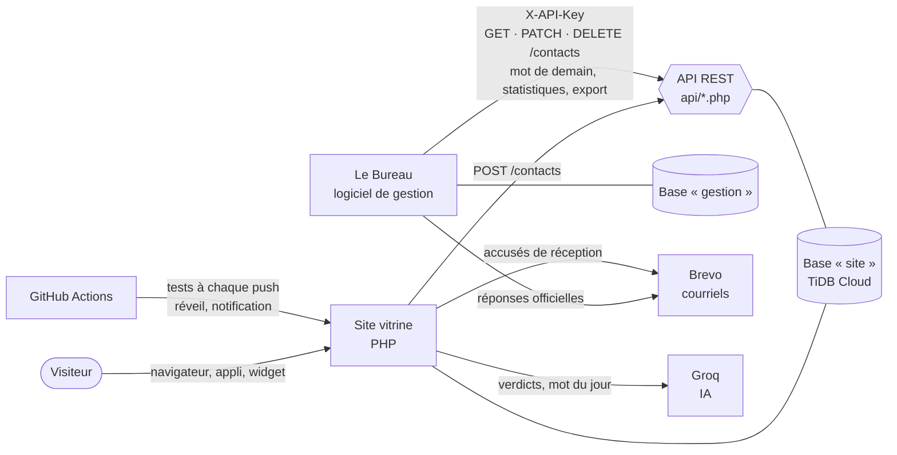

<p align="center">
  
</p>

<p align="center">
  <strong>Des conseils. C'est déjà ça.</strong><br>
  Un faux cabinet de conseil qui répond à vos problèmes par des conseils absurdes, avec le plus grand sérieux.
</p>

<p align="center">
  <a href="https://conseilplus.onrender.com"><strong>conseilplus.onrender.com</strong></a> ·
  <a href="https://conseilplus.onrender.com/developpeurs.php">L'API</a> ·
  <a href="https://conseilplus.onrender.com/bureau/">Le Bureau</a> ·
  <a href="https://github.com/Viktor59000/ConseilPlusPlus/releases/download/android/conseilplus.apk">Appli Android</a><br><br>
  <a href="https://github.com/Viktor59000/ConseilPlusPlus/actions/workflows/tests.yml"></a>
</p>

---

Projet du cours **« API PHP — Du site vitrine au logiciel de gestion »** (semestre 5) : un site vitrine en PHP / MySQL,
une **API REST** qui expose ses données, et un **logiciel de gestion** séparé (« Le Bureau ») qui ne communique avec
le site que par cette API.

## Le parcours noté, de bout en bout

Une demande de contact traverse les deux applications ; chaque flèche est un vrai appel, avec son vrai code HTTP
(vérifiés par [`tests/test_api.php`](tests/test_api.php)).



La dernière étape concerne le visiteur qui était connecté quand il a écrit : la demande porte alors son identifiant,
et la réponse s'affiche dans « Mon compte ». Les autres la reçoivent seulement par courriel.

## Exigences du sujet

| Exigence | Où dans le code | Preuve |
|---|---|---|
| **Site vitrine 3 pages + BDD** | [`index.php`](index.php), [`produit.php`](produit.php), [`contact.php`](contact.php) ; connexion unique [`includes/bdd.php`](includes/bdd.php), tables créées et migrées par [`includes/schema.php`](includes/schema.php) | [`tests/test_pages.php`](tests/test_pages.php) (toutes les pages, codes et CSP) ; [capture de l'accueil](docs/captures/accueil.webp) |
| **API REST : méthodes, codes, clé** | [`api/contacts.php`](api/contacts.php) (`POST` 201/422, `GET` 200/400/401, `PATCH` 200/404/422, `DELETE` 204/404) ; squelette commun [`includes/api.php`](includes/api.php) (`X-API-Key`, journal, limite de débit) | [`tests/test_api.php`](tests/test_api.php) : 201, 422, 401 sans clé, 403 avec une clé en lecture seule, 404, 204 |
| **Logiciel de gestion séparé qui consomme l'API** | [`bureau/`](bureau/), sa propre base `gestion` ; seul lien avec le site : [`bureau/includes/api.php`](bureau/includes/api.php) | [`docs/BUREAU.md`](docs/BUREAU.md) ; captures [tableau de bord](docs/captures/bureau.webp) et [fiche dossier](docs/captures/bureau-dossier.webp) |
| **Statut `nouveau` → `importe`** (puis `repondu`) | `relever_courrier()` et `publier_reponse()` dans [`bureau/includes/metier.php`](bureau/includes/metier.php) | `tests/test_api.php` : « PATCH (→ importe) » et « PATCH (→ repondu + réponse) » ; page Relevés du Bureau ([`bureau/journal.php`](bureau/journal.php)) |
| **Sécurité** | CSRF ([`includes/csrf.php`](includes/csrf.php)), requêtes préparées, CSP ([`includes/theme.php`](includes/theme.php)), clés hachées et droits ([`api/cles.php`](api/cles.php)), limite des essais ([`includes/limite-connexion.php`](includes/limite-connexion.php)), cookies ([`docker/securite.ini`](docker/securite.ini)), en-têtes ([`docker/apache.conf`](docker/apache.conf)) | `tests/test_api.php` (401, 403, clé révoquée) ; `tests/test_pages.php` (CSP sur chaque page) ; [docs/DEPLOIEMENT.md](docs/DEPLOIEMENT.md#sécurité-en-ligne) |
| **Tests automatiques** | [`.github/workflows/tests.yml`](.github/workflows/tests.yml) : syntaxe PHP, site lancé avec une vraie base MySQL | badge « Tests » ci-dessus ; [`tests/test_pages.php`](tests/test_pages.php), [`tests/test_api.php`](tests/test_api.php), [`tests/test_push.php`](tests/test_push.php) |
| **Documentation (OpenAPI, développeurs)** | une seule source, [`data/api.php`](data/api.php) → [`developpeurs.php`](developpeurs.php) (bouton « Essayer ») et [`api/openapi.php`](api/openapi.php) (OpenAPI 3.1) | `tests/test_api.php` : « GET /v1/ (description OpenAPI) » ; [capture de la documentation](docs/captures/api.webp) ; [docs/API.md](docs/API.md) |
| **Mise en ligne** | [`Dockerfile`](Dockerfile), [`docker/apache.conf`](docker/apache.conf) ; Render + TiDB Cloud, redéployé à chaque push | https://conseilplus.onrender.com ; [docs/DEPLOIEMENT.md](docs/DEPLOIEMENT.md) |

## En images


| Thème sombre | Le Petit Moyen | Mobile |
|---|---|---|
|  |  |  |

| Questions pour un stagiaire | Le cabinet | Documentation de l'API |
|---|---|---|
|  |  |  |

| Le Bureau : tableau de bord | Le Bureau : fiche dossier |
|---|---|
|  |  |

## Ce que fait le site

- **Le conseil du jour** : trois morceaux de phrases sans rapport, assemblés en un conseil officiel, tamponné et numéroté
  (« Dossier n° 4339-I »). Un autre conseil en un clic, sans compte. Sous le titre, un **article du règlement intérieur**,
  différent chaque jour.
- **Le Petit Moyen** : le mot (presque) du jour, fausse définition (avec sa fausse étymologie) ou sketch du conseiller et
  de son stagiaire, préparé chaque nuit par une IA (Groq), avec 175 mots et 41 sketchs en banque de secours.
  **Le sigle du jour** : un sigle connu redéfini par le mouvement abréviationniste du cabinet. Votes « Moyen / Pas moyen ».
- **Le cabinet** : l'équipe, dont chaque membre tient un service :
  - **Questions pour un stagiaire** (parodie non officielle) : le stagiaire buzze toujours le premier, le visiteur arbitre ;
  - **Messmerde**, mentaliste : expériences qui « devinent » des évidences, **prédictions rétroactives** (certificat
    « PRÉVU » horodaté après coup) et horoscope ;
  - **le standard** de Mireille : un répondeur à choix cliquables, musique d'attente, file qui finit à la machine à café ;
  - **les attestations** du tampon : on remplit d'abord **le formulaire du jour** de Bertrand, puis l'attestation est
    dessinée dans le navigateur (rien n'est envoyé) ;
  - **le diagnostic** « Quel client êtes-vous ? » (toujours moyen).
- **Nos formules** (et le faux paiement Premium), **Contact** avec accusé de réception par courriel. L'ancien guichet
  (`guichet.php`) n'existe plus : il redirige (301) vers Le cabinet.
- **Espace client** : Mon conseil, une **Consultation** (questionnaire inutile et verdict de l'IA), **Le Duel**
  (partie en 100 points contre le cabinet), **Mon carnet**, **Mon compte** : mes demandes de contact, leur statut et
  la réponse du cabinet, suppression des demandes et du compte (RGPD).
- **Mobile** : site installable, notification quotidienne du mot du jour (Web Push écrit à la main), **appli Android**
  avec son widget « Le Petit Moyen » ([`android/`](android/), APK construit et publié par
  [`android.yml`](.github/workflows/android.yml), clé de signature hors du dépôt), partage d'un conseil en image story.
- **Le Bureau** ([`bureau/`](bureau/), [docs/BUREAU.md](docs/BUREAU.md)) : relève les demandes par l'API, dossiers avec
  **affectation** à un agent et **échéance**, **notes internes**, historique des autres demandes de la même personne,
  **export CSV**, **purge** des demandes classées sur le site, réponses officielles par courriel (trois tons) **renvoyées
  au site** (lisibles dans « Mon compte »), **relecture du mot de demain** avant sa publication, journal des relevés,
  statistiques de l'API, clés d'API, sauvegarde des bases en un clic.

## Architecture



- Le Bureau a **sa propre base** et ne lit jamais celle du site : tout passe par l'API (clé `X-API-Key`).
- Chaque appel de l'API est **journalisé** (`api_logs` : date, ressource, code, application ; IP effacées après 90 jours).
- En ligne : **Render** (Docker, PHP 8.3 + Apache) et **TiDB Cloud** (MySQL, Francfort), redéployés à chaque push.

## L'API

La liste des routes n'est écrite qu'à un seul endroit, [`data/api.php`](data/api.php), d'où sont générées :

- la documentation lisible, avec le bouton « Essayer » : [en ligne](https://conseilplus.onrender.com/developpeurs.php)
  ou en local (http://localhost/Site/developpeurs.php) ;
- la description **OpenAPI 3.1** (à importer dans Postman, Insomnia ou Swagger UI) :
  [en ligne](https://conseilplus.onrender.com/api/openapi.php) ou `/api/v1/` en local.

Ressources : contacts, conseils, mot du jour (et modération du mot de demain), horoscope, widget, votes, notifications,
carnet du client, statistiques, sauvegarde, clés d'application. Principes (clés et droits, journal, limites de débit,
versions, pagination) et exemples `curl` des parcours importants : [docs/API.md](docs/API.md).

```bash
curl https://conseilplus.onrender.com/api/conseils.php
```

## Côté technique

| Sujet | Ce qui est en place |
|---|---|
| **PHP / MySQL** | PDO et requêtes préparées partout, tables créées et migrées automatiquement (`includes/schema.php`, rejoué seulement quand il change) |
| **Authentification** | Code du cours conservé tel quel (`auth/` : sel statique + SHA-512) ; mot de passe oublié par courriel (jeton haché, 1 h, usage unique) |
| **Sécurité** | Jetons CSRF, champ piège anti-robots, cookies `HttpOnly` / `Secure` / `SameSite`, CSP, HSTS, `X-Frame-Options`, limite des essais de connexion, limites de débit de l'API, clés d'application hachées |
| **Accessibilité** | RGAA 4.1 (déclaration : partiellement conforme, audit interne), contrastes vérifiés dans les deux thèmes, 320 px et texte à 200 % |
| **Performance** | Lighthouse mesuré en ligne le 22/10/2026 (profil mobile) : performance 93–100, accessibilité, bonnes pratiques et SEO 100 |
| **Design** | Identité « La note » : C+ entouré au stylo rouge, thèmes clair / sombre, animations ([charte](design-system/conseilplus/MASTER.md)) |
| **Tests** | À chaque push : syntaxe PHP, toutes les pages, API et Web Push sur une vraie base MySQL ([tests.yml](.github/workflows/tests.yml)) |
| **Données** | RGPD : pages légales, suppression des demandes et du compte, journal purgé, purge des demandes classées depuis Le Bureau ; sauvegarde des bases en un clic |

## Installation locale (WAMP)

1. Placer le dossier dans le `www` de WAMP (ou un lien, voir [docs/REPRISE.md](docs/REPRISE.md)).
2. Copier `config.example.php` en `config.php` et `bureau/config.example.php` en
   `bureau/config.php` (valeurs locales par défaut ; clés Groq et Brevo facultatives). `db.php` est déjà dans le dépôt.
3. Ouvrir `http://localhost/<dossier>/` : les bases `site` et `gestion` et leurs tables se créent au premier chargement.
   Le Bureau (`/bureau/`) propose alors de créer le premier agent (la clé `API_KEY` est demandée).
4. Tests : `php tests/test_pages.php`, `php tests/test_api.php`, `php tests/test_push.php`.

Mise en ligne, variables d'environnement et sauvegardes : [docs/DEPLOIEMENT.md](docs/DEPLOIEMENT.md).
Reprendre le projet sur un autre PC : [docs/REPRISE.md](docs/REPRISE.md). Où en est-on : [docs/JOURNAL.md](docs/JOURNAL.md).

## Soutenance : démo en 5 minutes

1. **Le site (1 min)** — l'accueil : la copie du conseil, « Un autre conseil », le tampon, l'article du règlement.
   Basculer en thème sombre. Le Petit Moyen : jouer un sketch, le sigle du jour. *Message : un site vitrine complet, avec une identité.*
2. **L'API (1 min 30)** — la page [L'API du cabinet](https://conseilplus.onrender.com/developpeurs.php) : « Essayer » sur
   `/conseils.php`, puis un `curl` sans clé sur `/contacts.php` (réponse `401`). *Message : une API REST documentée,
   avec des codes HTTP justes, une clé, des limites et un journal.*
3. **Le parcours site → API → Bureau (1 min 30)** — connecté, envoyer une demande depuis Contact (`201`, accusé de
   réception par courriel), puis dans Le Bureau : « Relever le courrier » (`GET`, puis `PATCH` → `importe`), ouvrir le
   dossier, l'affecter, rédiger une réponse « très administrative », l'envoyer (`PATCH` → `repondu`). Retour sur le site :
   la réponse est dans « Mon compte ». *Message : le logiciel de gestion ne touche jamais la base du site.*
4. **La qualité (1 min)** — les tests verts sur GitHub, la déclaration d'accessibilité, la limite des essais de connexion
   (« Trop d'essais »), la suppression du compte et la purge du Bureau. *Message : sécurité, RGAA et RGPD pris au sérieux,
   sur un sujet qui ne l'est pas.*

Questions à préparer : pourquoi le Bureau passe par l'API plutôt que par la base (séparation, clé, journal) ;
pourquoi le hachage du cours n'est pas modifié (contrainte du sujet, `password_hash()` serait la norme, et Le Bureau
l'utilise) ; que se passe-t-il si l'IA ne répond pas (banques de secours, le site ne dépend d'aucun service externe pour fonctionner).

## Arborescence

```
index.php, cabinet.php, petit-moyen.php, produit.php, contact.php          pages publiques (menu principal)
messmerde.php, stagiaire.php, standard.php, attestation.php, diagnostic.php  services de l'équipe
login.php, conseil.php, consultation.php, duel.php, carnet.php, compte.php    espace client
mot-de-passe-oublie.php, reinitialiser.php, developpeurs.php, application.php, erreur-404.php
mentions-legales.php, confidentialite.php, accessibilite.php, plan-du-site.php
guichet.php    ancien guichet : redirection 301 vers cabinet.php
auth/          connexion, inscription, déconnexion (code du cours, non modifié)
api/           l'API REST (contacts, conseils, mot-du-jour, horoscope, widget, votes, notifications,
               mes-conseils, statistiques, export, cles, openapi)
bureau/        Le Bureau, logiciel de gestion (sa propre base « gestion »)
includes/      init, BDD et schéma, client HTTP, squelette de l'API, IA, courriels, Web Push, sécurité, générateurs
data/          banques de contenu (fragments, Kamoulox, mots, sketchs, sigles, règlement, formulaires…) et routes de l'API
css/ js/       base.css (socle commun), style.css ; un script par fichier, chargé en defer
assets/        polices, icônes, logo, portraits de l'équipe, images des courriels
android/       appli Android et son widget (APK construit par GitHub Actions)
tests/         tests des pages, de l'API et du Web Push
docs/          API, Bureau, déploiement, reprise, journal, idées, images, captures ; design-system/ : la charte
docker/, Dockerfile, .github/workflows/      mise en ligne, tests, réveil, garde éveillé, appli Android
```

## Crédits

Contenus originaux. Le générateur de conseils et les sketchs du Petit Moyen sont un **hommage non officiel** au
Kamoulox (Kad Merad et Olivier Baroux) et aux « Mots » (Éric et Ramzy) : aucune réplique ni aucun visuel n'est repris.
« Questions pour un stagiaire » est une parodie non officielle d'un jeu télévisé, sans lien avec l'émission.
Les personnes citées dans les conseils le sont dans des situations inoffensives et imaginaires. Polices
Schibsted Grotesk et JetBrains Mono (SIL Open Font License). Portraits de l'équipe générés par IA ([docs/IMAGES.md](docs/IMAGES.md)).
